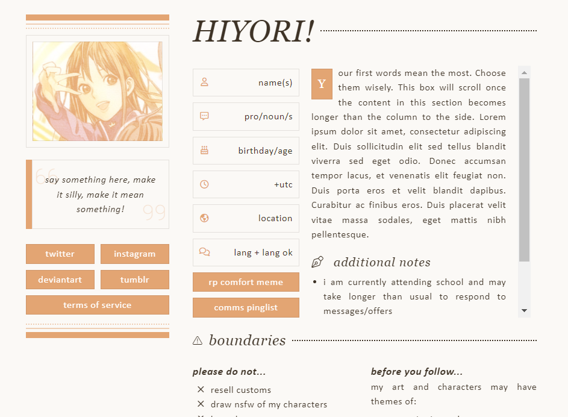
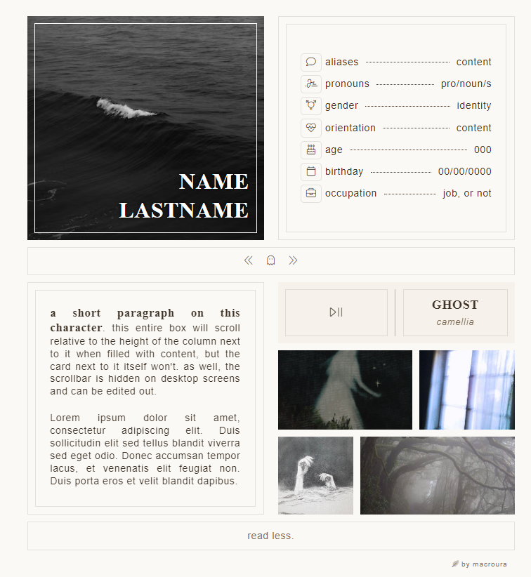
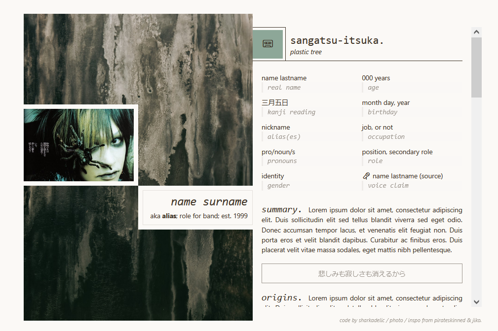
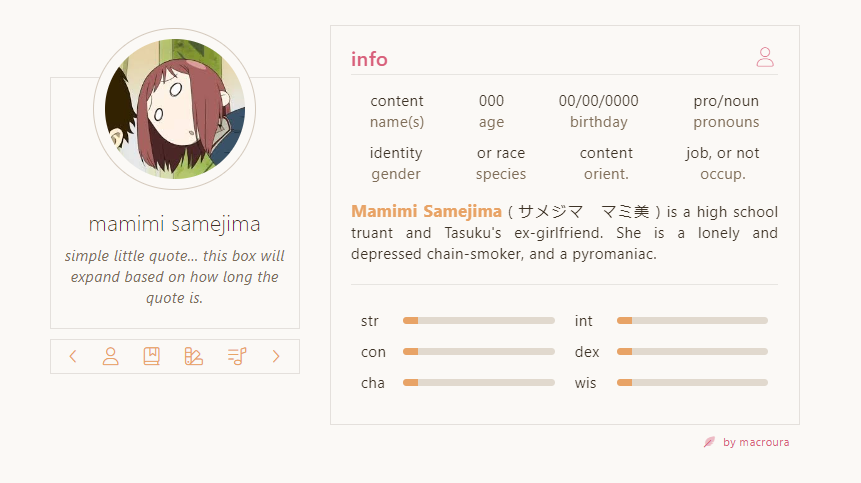

+++
title = "Sharkadelic Storefront"
date = 2021-10-06
[taxonomies]
tags=["Personal","Freelance"]
[extra]
cover = "projects/toyhouse/image.png"
gloss = "An assortment of web design projects created independently for Toyhouse users."
+++

## What It Is
Toyhouse is a website for creatives, artists, and writers to store information about their stories, art, and designs. A unique feature of the site is the ability for users to customize nearly every aspect of their account through HTML snippets and templates, colloquially known as **codes**. Since Toyhouse's front-end utilizes a customized release of Bootstrap 4.0, all "codes" written specifically for the site use this format. Toyhouse also offers the option for users to customize the CSS of their pages through external stylesheets that may also be stored on the site.

# Development
From 2021 to 2024, I was very active on Toyhouse and uploaded templates monthly or every other month. Most of my free time in high school was spent designing and creating templates, teaching myself Bootstrap 4.0 and Sass through the work I designed and published onto the site. Through trial-and-error, I learned to cultivate my own "style" of graphic web design, where I aimed for a minimalist yet energetic feeling.

    

        
    

    

        
    

    

        
    

    

        
    

I was also involved with the online Toyhouse coding community, in the form of on-site forums and off-site specialty Discord servers, where I would aid and troubleshoot my peers' designs and code, as well as request assistance with my own.

The nature of Bootstrap as a framework built for facilitating responsive website design is something that I really took in stride. Without this experience, I doubt that I would have placed the same importance on responsive design and accessibility as I do now within my personal web design projects.

## Process
I usually begin by planning out the basic layout 

## Roles
- **Web Designer**
- **Storefront Owner & Manager**

I designed and developed all templates shown as examples above and on my Toyhouse page.

## Tools

- Visual Studio Code

## Relevant Links
[Toyhouse Page](https://toyhou.se/sharkadelic/)